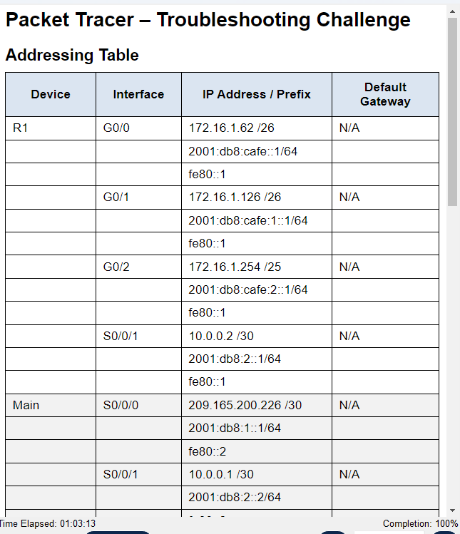
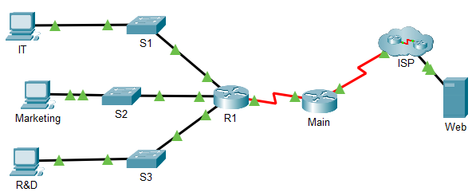

# Cisco Packet Tracer – Troubleshooting Challenge (17.8.3)

## 📌 Deskripsi
Menyelesaikan tantangan troubleshooting jaringan LAN dengan topologi 
Router-on-a-Stick, melibatkan IPv4 & IPv6, konfigurasi SSH, dan routing statis.

## 🎯 Tujuan
- Memperbaiki kesalahan konfigurasi pada LAN, switch, dan router.
- Memastikan semua PC bisa ping Web Server (IPv4 & IPv6).
- Memastikan semua PC bisa SSH ke Router R1.

## 🛠️ Tools
- Cisco Packet Tracer
- IPv4, IPv6, VLAN 1, SSH, Static Routing

## 🔍 Masalah yang Ditemukan & Diperbaiki
| Perangkat | Masalah | Solusi |
|-----------|---------|--------|
| Switch S1/S2/S3 | VLAN 1 belum dikonfigurasi | Set IP, subnet mask, gateway default |
| Router R1 | IP G0/1 salah (192.168.1.126) | Diubah ke 172.16.1.126/26 |
| Router R1 | SSH belum aktif | Set username, `transport input ssh`, crypto key |
| PC R&D | IPv6 salah ketik | Perbaiki alamat IPv6 |

## ✅ Hasil Akhir
Assessment Packet Tracer: **100%**

## 📷 Bukti

## 📚 Pelajaran yang Didapat
- Troubleshooting sistematis dari layer bawah ke atas.
- Pentingnya subnet mask yang tepat.
- Konfigurasi SSH pada Cisco IOS.
- Routing statis IPv4 dan IPv6.